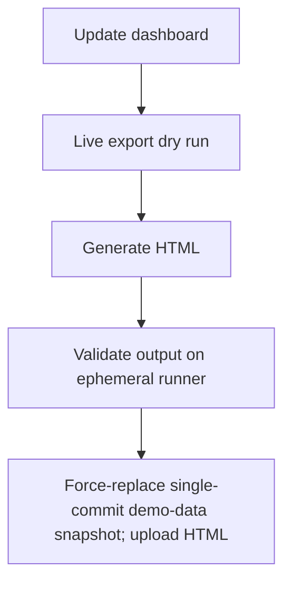

# Workflow Notes

This repo currently ships five GitHub Actions workflows.

## Workflow summary

| Workflow | File | Purpose |
|---|---|---|
| Update Vulnerability Dashboard | `.github/workflows/update-vulnerability-dashboard.yml` | Exact owner repository on main, or private repositories: validate and publish allowlisted dashboard outputs after demo tenant verification |
| Validate Dashboard | `.github/workflows/validate-dashboard.yml` | Run the deterministic repo preflight used for local and PR validation |
| Build Azure Package | `.github/workflows/sync-azure-package.yml` | Build the latest Azure deployment zip and upload it as a downloadable workflow artifact |
| Release Azure Package | `.github/workflows/release-azure-package.yml` | Build `Azure-YYMMDD.zip` from the published release tag and attach it to the GitHub release |
| Export Dashboard PDFs | `.github/workflows/export-pdf-reports.yml` | Private repositories only: render PDFs without publishing live reports; remains disabled pending a private source |

The dashboard job admits `(nathanmcnulty/defender-reporting AND refs/heads/main) OR private: true`; other public or unknown repositories skip before checkout or authentication. The public owner workflow is manually disabled while its demo-data publication policy is unresolved. Existing public snapshots remain accessible. The PDF job remains private-only, read-only and unchanged, with publishing disabled. Exporter logs can expose RBAC group IDs and counts.

## Flow

## Update Vulnerability Dashboard

Trigger sources, when enabled:

- Daily schedule at `02:00 UTC`
- Manual run

Key behavior:

- Uses repo-owned Azure OIDC logic through `build/Invoke-LiveDashboardDryRun.ps1`
- Restores incremental export state from the `demo-data` branch, then uses repository output paths for HTML and named gzip stores; audit and manifest stay under ignored `.local/`
- Stages only the dashboard allowlist into an orphan worktree, force-pushes it as the single commit on `demo-data` (never `main`), and uploads only HTML with 30-day retention after validation
- Manual `dry_run: true` still collects live data, but skips staging, commits and artifacts
- Owner runs require configured tenant GUID, matching Az context/token tenants, and no ambient CLI fallback; private/local behavior otherwise remains unchanged
- The workflow definition retains the daily `02:00 UTC` schedule; the public owner workflow is currently manually disabled, so neither scheduled nor manual runs start

## Validate Dashboard

Trigger sources:

- Pull requests that touch scripts, templates, or workflow files
- Pushes to `main` for the same paths
- Manual run

Key behavior:

- Installs pinned `PSScriptAnalyzer` and `Az.Accounts` versions (workflow `env`) and caches them
- Calls the repo-owned `build/Invoke-RegressionValidation.ps1` entrypoint
- Validates generated deployment artifacts, source scripts, regression helpers, the build-layer template publish contract, and fixture-based dashboard generation through one deterministic path
- Fails when the committed `azure/Invoke-DashboardPipeline.ps1` or `azure/Upload-Templates.ps1` differs from what the preflight regenerates; regenerate them in the same PR instead of relying on a bot commit
- Builds and extracts the Azure zip, asserts that it contains no `build/` dependency, and smoke-tests the packaged `azure/Upload-Templates.ps1` entrypoint

## Export Dashboard PDFs

Trigger sources:

- Manual run today
- Optional scheduled run in a private repository if you uncomment the cron entry in the workflow

Key behavior:

- Checks whether committed PDF exports are older than `VulnerabilityDashboard.html` on the `demo-data` branch, and restores that HTML before export
- Uses Playwright and `.github/scripts/export-pdf-reports.js`
- Does not commit or upload generated PDFs
- Runs only in private repositories; remains disabled/skipped in public repositories
- In private repositories, remains disabled until a private dashboard source replaces the demo HTML

## Build Azure Package

Trigger sources:

- Pushes to `main` that change Azure package inputs
- Manual run

Key behavior:

- Installs `Az.Accounts`
- Runs `build/Build-AzureReleasePackage.ps1`
- Packages `Setup-AzureResources.ps1`, `templates/`, and `azure/` into `Azure-YYMMDD-<commit>.zip`
- Uploads that zip as a workflow artifact for download from the Actions run

## Release Azure Package

Trigger sources:

- Published GitHub releases

Key behavior:

- Checks out the published release tag so the package matches the release contents
- Installs `Az.Accounts`
- Runs `build/Build-AzureReleasePackage.ps1`
- Packages `Setup-AzureResources.ps1`, `templates/`, and `azure/` into `Azure-YYMMDD.zip`
- Uploads the zip as a release asset, replacing any existing asset with the same name

## Suggested operating model

- Enable the public dashboard refresh only after approving a safe data and log publication policy and, if using live data, verifying the owner demo tenant binding; private repositories must also review their destination access controls
- Let the validation workflow protect changes to scripts and templates through the same deterministic preflight used locally
- Regenerate `azure/Invoke-DashboardPipeline.ps1` and `azure/Upload-Templates.ps1` in the PR that changes their sources; the validation workflow rejects stale artifacts
- Use the Azure package workflow when you want a fresh downloadable deployment bundle without committing a binary into the repository
- Publish a GitHub release when you want the release-specific `Azure-YYMMDD.zip` asset attached automatically
- Use `tests/Invoke-AzureRunbookValidation.ps1` for guarded, temporary candidate validation against a real Automation account; it requires an explicit subscription and restores the runbook and storage state after the run
- Run the PDF workflow only in a private repository with a private dashboard source, when the HTML dashboard changes enough to warrant fresh report exports
- Use `build/Invoke-LiveDashboardDryRun.ps1 -UseExistingAzContext` locally when you need exact-path validation for the live export flow before deploying to access-controlled storage

## Related docs

- [Azure setup](azure-setup.md)
- [GitHub Actions setup](github-actions-setup.md)
